# 💬 Awesome Live Chat & Website Visitor Tracking 🌐

 
 

  

> ⚡ **A definitive, SEO-optimized directory of enterprise SaaS Live Chat widgets, real-time website visitor tracking platforms, AI customer support agents, and high-performance open-source self-hosted alternatives.**

---

## 📑 Table of Contents

- [🌐 Sector Overview & Market Dynamics](#-sector-overview--market-dynamics)
- [🏢 SaaS / Hosted Platforms](#-saas--hosted-platforms)
  - [📊 SaaS Platforms Comparison Table](#-saas-platforms-comparison-table)
  - [🔍 Detailed SaaS Profiles](#-detailed-saas-profiles)
- [🟩 Open-Source Software](#-open-source-software)
  - [⭐ Open-Source Solutions Comparison Table](#-open-source-solutions-comparison-table)
  - [🛠️ Detailed Open-Source Profiles](#-detailed-open-source-profiles)
- [⚖️ Architectural Comparison: SaaS vs Self-Hosted](#️-architectural-comparison-saas-vs-self-hosted)
- [📈 Key Evaluation Criteria for Live Chat & Visitor Tracking](#-key-evaluation-criteria-for-live-chat--visitor-tracking)
- [⭐ Star History](#-star-history)
- [💖 Support](#-support)
- [🤝 Contributing](#-contributing)
- [📄 License](#-license)

---

## 🌐 Sector Overview & Market Dynamics

The global market for live chat software, conversational marketing, and website visitor tracking solutions is currently valued at approximately **$1.1–$1.4 billion** and is projected to exceed **$2.8 billion by 2030**, advancing at a Compound Annual Growth Rate (**CAGR of ~11.2%**). 

The industry experiences **moderate fragmentation across mid-market and SMB customer engagement tiers, alongside notable enterprise consolidation**. Market leaders such as Zoho, Freshworks, Intercom, and Drift (Salesloft) dominate multi-channel CRM ecosystems by integrating generative AI agents (Fin, Freddy AI, Zobot) that automate tier-1 support tickets and qualify inbound sales leads. Simultaneously, stringent international data protection mandates (GDPR, CCPA, HIPAA) and growing cloud hosting costs have sparked strong momentum behind self-hosted, privacy-first open-source solutions (Chatwoot, Rocket.Chat, PostHog, Matomo).

---

## 🏢 SaaS / Hosted Platforms

Managed cloud platforms provide out-of-the-box infrastructure, real-time visitor tracking, automated bots, multi-channel messaging (WhatsApp, email, social), CRM integrations, and mobile support applications.

### 📊 SaaS Platforms Comparison Table

*The table is sorted by company size (valuation / revenue) in descending order.*

| Platform | Company Size (Valuation / Revenue) | Starting Tier Pricing | Free Tier Limits / Trial | Real-Time Visitor Tracking | AI Chatbots / Automation | Primary Focus |
|:---|:---|:---|:---|:---:|:---:|:---|
| **[Zoho SalesIQ](https://www.zoho.com/salesiq/)** | ~$1.2B+ ARR (Zoho Corp Private Valuation ~$10B–$15B) | **$7/operator/month** (Basic plan, billed annually) | **Free Forever plan**: 3 operators, 100 chat sessions/month, 1,000 tracked visitors/month (15-day Enterprise trial with all features) | ✅ Deep visitor path tracking | ✅ Zobot + Answer Bot | Integrated sales engagement & visitor tracking |
| **[Freshchat](https://www.freshworks.com/live-chat-software/)** | ~$4.3B Market Cap / ~$600M+ ARR (Freshworks NASDAQ: FRSH) | **$19/agent/month** (Growth plan, billed annually) | **Free Forever plan**: up to 10 agents, 100 chatbot conversations (21-day Pro trial with all features) | ✅ Real-time visitor activity | ✅ Freddy AI bots | Omnichannel customer service & messaging |
| **[Intercom](https://www.intercom.com/)** | ~$3.9B Valuation / ~$250M+ ARR | **$39/seat/month** (Essential plan, billed annually) | **14-day Free Trial**: Unlimited access to Essential/Advanced features (No free-forever plan) | ✅ Real-time visitor tracking & segments | ✅ Fin AI Agent | Conversational engagement, support & AI agent |
| **[Drift](https://www.drift.com/)** | ~$1.2B Valuation (Acquired by Salesloft) | **$2,500/month** (Premium tier, billed annually) | **30-day Free Trial**: Guided enterprise demo & trial environment (No free-forever plan) | ✅ Account-based visitor identification | ✅ AI conversational bots | B2B revenue acceleration & ABM live chat |
| **[LiveChat](https://www.livechat.com/)** | ~$600M+ Market Cap / ~$80M+ ARR (Text S.A. WSE: TXT) | **$20/agent/month** (Starter plan, billed annually) | **14-day Free Trial**: Full-featured Team tier testing with unlimited chats (No free-forever plan) | ✅ Real-time visitor list & page views | ✅ ChatBot integration | Dedicated live support & ticketing |
| **[Tidio](https://www.tidio.com/)** | ~$100M+ Valuation / ~$20M+ ARR | **$29/month** (Starter plan with 3 seats) | **Free Forever plan**: 50 live chat conversations/month, 100 Lyro AI bot triggers, 3 operators (7-day trial of paid tiers) | ✅ Live visitor preview | ✅ Lyro AI conversational bot | E-commerce live chat & sales automation |
| **[Tawk.to](https://www.tawk.to/)** | ~$15M–$20M ARR (Bootstrapped / Self-Funded) | **$0/month** ($1/hr for optional human hire agents) | **100% Free Forever**: Unlimited agents, unlimited chat history, unlimited concurrent visitors, ticketer included | ✅ Real-time monitoring & geo-tracking | ⚠️ Basic triggers only (AI Assist paid add-on) | 100% free live chat & real-time monitoring |
| **[Leadfeeder](https://www.dealfront.com/leadfeeder/)** | ~$120M Merger (Dealfront) / ~$15M+ ARR | **€99/month** (~$108/month, billed annually) | **Free Forever plan**: 7-day data retention, max 10 identified companies/month (14-day Premium trial with unlimited leads) | ✅ B2B IP de-anonymization & page tracking | ❌ (Focus on analytics/lead gen) | B2B website visitor identification & intent data |
| **[Crisp](https://crisp.chat/)** | ~$10M–$15M ARR (Bootstrapped) | **$25/workspace/month** (Pro plan, includes 4 seats) | **Free Forever plan**: 2 seats, basic website chat widget, 30-day chat history (14-day Unlimited trial) | ✅ Real-time visitor viewing & magic browse | ✅ Bot plugin & triggers | Shared team inbox & real-time visitor co-browsing |
| **[Olark](https://www.olark.com/)** | ~$8M–$12M ARR (Bootstrapped) | **$29/agent/month** (Standard plan, billed annually) | **14-day Free Trial**: Full feature access up to 20 operators (Free tier discontinued; trial requires no credit card) | ✅ Live visitor monitoring & cart inspection | ✅ Automated chat rules | Lightweight live chat with real-time visitor insights |

---

### 🔍 Detailed SaaS Profiles

#### 1. 🌐 Zoho SalesIQ
- **Website**: [https://www.zoho.com/salesiq/](https://www.zoho.com/salesiq/)
- **Pricing**: From $7/operator/month (billed annually)
- **Free Tier / Trial**: Free Forever plan (3 operators, 100 chat sessions/month, 1,000 tracked visitors/month); 15-day Enterprise trial.
- **Key Capabilities**: Proactive visitor rings based on engagement scores, CRM integration, audio calls, live screen sharing, multilingual translation, and custom bots (Zobot).

#### 2. ⚡ Freshchat
- **Website**: [https://www.freshworks.com/live-chat-software/](https://www.freshworks.com/live-chat-software/)
- **Pricing**: From $19/agent/month (Growth plan, billed annually)
- **Free Tier / Trial**: Free Forever plan for up to 10 agents with 100 bot sessions; 21-day unrestricted Pro trial.
- **Key Capabilities**: Omnichannel support across WhatsApp, LINE, Facebook Messenger, unified agent workspace, Freddy AI Copilot, and proactive campaigns.

#### 3. 🤖 Intercom
- **Website**: [https://www.intercom.com/](https://www.intercom.com/)
- **Pricing**: From $39/seat/month (billed annually)
- **Free Tier / Trial**: 14-day Free Trial with access to Essential/Advanced tier capabilities.
- **Key Capabilities**: Enterprise conversational ticketing, Fin AI Agent powered by Claude/OpenAI, proactive product tours, user segmentation, and in-depth outbound messages.

#### 4. 🎯 Drift
- **Website**: [https://www.drift.com/](https://www.drift.com/)
- **Pricing**: From $2,500/month (billed annually)
- **Free Tier / Trial**: 30-day Free Trial and tailored enterprise sandbox environments.
- **Key Capabilities**: Account-based marketing (ABM) routing, conversational landing pages, instant qualification bots, and real-time meeting scheduling directly inside chat.

#### 5. 🗨️ LiveChat
- **Website**: [https://www.livechat.com/](https://www.livechat.com/)
- **Pricing**: From $20/agent/month (billed annually)
- **Free Tier / Trial**: 14-day Free Trial on the Team tier with full feature access.
- **Key Capabilities**: Sneak peek typing indicators, canned responses, file sharing, customer feedback scoring, tag management, and 200+ native integrations.

#### 6. 🛍️ Tidio
- **Website**: [https://www.tidio.com/](https://www.tidio.com/)
- **Pricing**: From $29/month (Starter tier, includes 3 seats)
- **Free Tier / Trial**: Free Forever plan (50 chat conversations/month, 100 AI bot triggers); 7-day trial of paid tiers.
- **Key Capabilities**: Seamless Shopify/WooCommerce integration, live visitor list with shopping cart view, pre-built e-commerce chatbots, and Lyro conversational AI.

#### 7. 🦜 Tawk.to
- **Website**: [https://www.tawk.to/](https://www.tawk.to/)
- **Pricing**: $0/month (Completely free; optional human live chat agents available at $1/hr)
- **Free Tier / Trial**: 100% Free Forever with unlimited agents, unlimited chats, and real-time visitor monitoring.
- **Key Capabilities**: Live visitor geo-tracking, visitor page path monitoring, knowledge base, ticketing system, and mobile apps for iOS and Android.

#### 8. 🔍 Leadfeeder
- **Website**: [https://www.dealfront.com/leadfeeder/](https://www.dealfront.com/leadfeeder/)
- **Pricing**: From €99/month (~$108/month, billed annually)
- **Free Tier / Trial**: Free Forever plan (max 10 identified companies/month, 7-day data retention); 14-day unlimited trial.
- **Key Capabilities**: Identification of anonymous B2B company visits via reverse DNS/IP tracking, LinkedIn employee lookup, behavioural scoring, and CRM synchronisation.

#### 9. 🚀 Crisp
- **Website**: [https://crisp.chat/](https://crisp.chat/)
- **Pricing**: From $25/workspace/month (includes 4 seats)
- **Free Tier / Trial**: Free Forever plan (2 seats, standard website live chat widget); 14-day Unlimited trial.
- **Key Capabilities**: Magic Browse (co-browsing with website visitors), live visitor map, audio/video calling directly in chat, status page, and automated campaigns.

#### 10. 💡 Olark
- **Website**: [https://www.olark.com/](https://www.olark.com/)
- **Pricing**: From $29/agent/month (billed annually)
- **Free Tier / Trial**: 14-day Free Trial with complete feature set.
- **Key Capabilities**: Real-time visitor activity alerts, automated chat triggers, live chat transcripts, team performance reports, and webhook notifications.

---

## 🟩 Open-Source Software

Self-hosted and open-source customer communication and visitor tracking systems offer full control over user data, compliance with GDPR/HIPAA standards, and zero subscription costs or seat caps.

### ⭐ Open-Source Solutions Comparison Table

*The table is sorted by GitHub Stars in descending order.*

| Project | Stars | Tech Stack | License | Core Capabilities |
|:---|:---:|:---|:---|:---|
| **[Rocket.Chat](https://github.com/RocketChat/Rocket.Chat)** |  | JavaScript / TypeScript (Node.js, React) | MIT | Omnichannel live chat widget, enterprise team collaboration, matrix federation, visitor queue management |
| **[PostHog](https://github.com/PostHog/posthog)** |  | Python / TypeScript (Django, React, ClickHouse) | MIT | Real-time visitor session replay, event analytics, funnel tracking, user cohort paths, feature flags |
| **[Chatwoot](https://github.com/chatwoot/chatwoot)** |  | Ruby on Rails / Vue.js | MIT | Direct Intercom/Zendesk alternative, live chat widget, shared inbox, omnichannel (WhatsApp, SMS, Email, Telegram) |
| **[Matomo](https://github.com/matomo-org/matomo)** |  | PHP / JavaScript (Vue.js, MySQL) | GPL-3.0 | Real-time visitor log, detailed user profiles, geolocation tracking, heatmaps, form analytics, GDPR compliance |
| **[OpenReplay](https://github.com/openreplay/openreplay)** |  | Go / TypeScript (React, Redux) | Fair Source (ELv2) | Self-hosted session replay, live co-browsing with visitors, DevTools inspection, omni-channel tracking |
| **[Papercups](https://github.com/papercups-io/papercups)** |  | Elixir / TypeScript (Phoenix, React) | MIT | Lightweight open-source live chat widget, Slack/Mattermost sync, visitor metadata capture, customizable UI |
| **[Zammad](https://github.com/zammad/zammad)** |  | Ruby / JavaScript | AGPL-3.0 | Omnichannel customer support desk, customizable live chat widget, ticket tracking, audit logs |
| **[FreeScout](https://github.com/freescout-help-desk/freescout)** |  | PHP (Laravel, MySQL) | AGPL-3.0 | Help desk & shared mailbox, live web chat module, visitor notification triggers, 100% self-hosted |
| **[Chaskiq](https://github.com/chaskiq/chaskiq)** |  | Ruby on Rails / React | Apache-2.0 | Conversational marketing, proactive messaging triggers, visitor onboarding tours, newsletter campaigns |
| **[GO-FLY](https://github.com/taoshihan1991/goflylivechat)** |  | Go (Gin, WebSocket, Vue) | MIT | High-performance Go live chat daemon, low resource footprint, real-time visitor notifications, standalone binary |
| **[Live Helper Chat](https://github.com/LiveHelperChat/livehelperchat)** |  | PHP / JavaScript | Apache-2.0 | Dedicated live support system, real-time visitor tracking & footpaths, co-browsing, proactive invitations, Telegram bot |
| **[Bytedesk](https://github.com/Bytedesk/bytedesk)** |  | Java (Spring Boot) / Vue / Flutter | Apache-2.0 | AI-powered live chat widget, ticket management, omnichannel agent dispatching, mobile SDKs |

---

### 🛠️ Detailed Open-Source Profiles

#### 1. 🚀 Rocket.Chat
- **Repository**: [https://github.com/RocketChat/Rocket.Chat](https://github.com/RocketChat/Rocket.Chat)
- **Stargazers**: 
- **Tech Stack**: JavaScript / TypeScript (Node.js, Meteor, React) | **License**: MIT
- **Overview**: Enterprise-grade communication hub with a powerful embedded live chat widget (`Livechat`). Supports incoming visitor queues, agent routing, file exchange, CRM integrations, and encrypted messaging.

#### 2. 🦔 PostHog
- **Repository**: [https://github.com/PostHog/posthog](https://github.com/PostHog/posthog)
- **Stargazers**: 
- **Tech Stack**: Python / TypeScript (Django, React, ClickHouse) | **License**: MIT
- **Overview**: Comprehensive product operating system delivering real-time visitor recording, click maps, user conversion funnels, behavioral analytics, and session replay to track website user journeys.

#### 3. 💬 Chatwoot
- **Repository**: [https://github.com/chatwoot/chatwoot](https://github.com/chatwoot/chatwoot)
- **Stargazers**: 
- **Tech Stack**: Ruby on Rails / Vue.js | **License**: MIT
- **Overview**: An open-source customer engagement suite engineered as an alternative to Intercom and Zendesk. Includes an embeddable website live chat widget, conversation routing, auto-responders, and integrations with WhatsApp, Facebook, and Email.

#### 4. 📊 Matomo
- **Repository**: [https://github.com/matomo-org/matomo](https://github.com/matomo-org/matomo)
- **Stargazers**: 
- **Tech Stack**: PHP / JavaScript (Vue.js, MySQL) | **License**: GPL-3.0
- **Overview**: Industry-standard open-source web analytics platform featuring real-time visitor logs, individualized visitor profiles, page transition paths, geographic maps, and GDPR-compliant data isolation.

#### 5. 🎥 OpenReplay
- **Repository**: [https://github.com/openreplay/openreplay](https://github.com/openreplay/openreplay)
- **Stargazers**: 
- **Tech Stack**: Go / TypeScript (React) | **License**: Fair Source (ELv2)
- **Overview**: Self-hosted session replay and co-browsing suite allowing teams to see exactly what visitors do on their website, inspect console logs, debug network requests in real time, and co-browse during live support sessions.

#### 6. ☕ Papercups
- **Repository**: [https://github.com/papercups-io/papercups](https://github.com/papercups-io/papercups)
- **Stargazers**: 
- **Tech Stack**: Elixir / TypeScript (Phoenix Framework, React) | **License**: MIT
- **Overview**: Lightweight customer messaging platform with a reactive chat widget that can reply to visitors straight from internal Slack or Mattermost channels without requiring agents to open a separate portal.

#### 7. 🛡️ Zammad
- **Repository**: [https://github.com/zammad/zammad](https://github.com/zammad/zammad)
- **Stargazers**: 
- **Tech Stack**: Ruby / JavaScript | **License**: AGPL-3.0
- **Overview**: Web-based open-source helpdesk and customer support system featuring a native live chat widget, multi-channel intake, SLA monitoring, and role-based permissions.

#### 8. 🕊️ FreeScout
- **Repository**: [https://github.com/freescout-help-desk/freescout](https://github.com/freescout-help-desk/freescout)
- **Stargazers**: 
- **Tech Stack**: PHP (Laravel, MySQL) | **License**: AGPL-3.0
- **Overview**: Lightweight, self-hosted helpdesk and shared mailbox solution designed as an alternative to Help Scout and Zendesk. Features official live web chat and notification modules.

#### 9. 📣 Chaskiq
- **Repository**: [https://github.com/chaskiq/chaskiq](https://github.com/chaskiq/chaskiq)
- **Stargazers**: 
- **Tech Stack**: Ruby on Rails / React | **License**: Apache-2.0
- **Overview**: Conversational marketing and support platform featuring targeted onboarding popups, proactive web messenger triggers, custom in-app tours, and video recording support.

#### 10. 🏎️ GO-FLY
- **Repository**: [https://github.com/taoshihan1991/goflylivechat](https://github.com/taoshihan1991/goflylivechat)
- **Stargazers**: 
- **Tech Stack**: Go (Gin, WebSocket, Vue) | **License**: MIT
- **Overview**: High-speed, self-hosted customer support live chat system written in Go. Designed with low CPU and memory footprints, real-time WebSocket messaging, and automated welcome routing.

#### 11. 🤝 Live Helper Chat
- **Repository**: [https://github.com/LiveHelperChat/livehelperchat](https://github.com/LiveHelperChat/livehelperchat)
- **Stargazers**: 
- **Tech Stack**: PHP / JavaScript | **License**: Apache-2.0
- **Overview**: Dedicated open-source live support software featuring real-time website visitor monitoring, visitor footpaths, co-browsing, proactive engagement prompts, and Telegram/WhatsApp integration.

#### 12. ⚡ Bytedesk
- **Repository**: [https://github.com/Bytedesk/bytedesk](https://github.com/Bytedesk/bytedesk)
- **Stargazers**: 
- **Tech Stack**: Java (Spring Boot) / Vue / Flutter | **License**: Apache-2.0
- **Overview**: Multi-tenant customer service system combining real-time live chat, ticketing, AI bot orchestration, and cross-platform client SDKs.

---

## ⚖️ Architectural Comparison: SaaS vs Self-Hosted

| Operational Factor | Managed SaaS (Zoho, Intercom, Freshchat) | Self-Hosted Open-Source (Chatwoot, Rocket.Chat, Matomo) |
|:---|:---|:---|
| **Deployment Time** | ⚡ Instant (< 5 minutes via snippet) | ⏱️ 10–30 minutes (Docker / Kubernetes setup) |
| **Data Privacy & Compliance** | 🔒 Vendor processes and stores data in their cloud | 🛡️ 100% On-Premise / Absolute GDPR & HIPAA compliance |
| **Agent / Seat Fees** | 💳 $7 to $39+ per seat/month | 🚀 Unlimited agents & chat histories for $0 license cost |
| **Visitor Tracking Limits**| 📊 Tiered caps on monthly tracked visitors | 📈 Unlimited visitor logging bounded only by database storage |
| **AI Agents & Bots** | 🤖 Pre-integrated native AI bots (Fin, Freddy, Zobot) | 🧩 Open-source integrations via LangChain, Ollama, or OpenAI API |
| **Infrastructure Overhead**| ☁️ Fully managed, 99.9% uptime SLA | 🛠️ Requires maintenance, backups, and SSL configuration |

---

## 📈 Key Evaluation Criteria for Live Chat & Visitor Tracking

When selecting an enterprise live chat or visitor analytics solution, consider the following technical and operational dimensions:

1. **Latency & Page Load Impact**: Look for asynchronous, tree-shakeable client widget bundles (< 50 KB gzip) that do not degrade Google Core Web Vitals (LCP, FID/INP).
2. **Reverse DNS & IP De-Anonymization**: B2B platforms require reliable corporate IP lookup to reveal which organizations visit your pricing and product pages.
3. **Omnichannel Federation**: Ability to aggregate interactions across web chat widgets, mobile push notifications, WhatsApp Business API, Facebook Messenger, and Email into a single unified agent interface.
4. **Data Sovereignty & Retention**: GDPR and CCPA compliance necessitates configurable data retention schedules, automated cookie consent integration, and on-premise database storage options.
5. **AI Handoff & Hybrid Workflows**: Seamless escalation paths from automated LLM/agentic bots to human support staff with full conversational context and session telemetry.

---

##  Star History

---

## 💖 Support

If you find this curated collection of live chat and website visitor tracking tools valuable:

- ⭐ **Star this repository** on GitHub to help other engineers, founders, and customer success teams discover it!
- 🍴 **Fork the repository** to contribute new solutions, update pricing tiers, or refine feature matrices.
- 📢 **Share this list** on LinkedIn, X/Twitter, developer subreddits, and tech Discords.
- ☕ **Buy a Coffee / Sponsor the Maintainer**: Support ongoing open-source curation and research via the **[GitHub Sponsors Dashboard](https://github.com/sponsors/ishandutta2007)**!

Thank you for supporting open source and open tools! 🚀

---

## 🤝 Contributing

Contributions are warmly welcomed!

If you know of an outstanding open-source live chat tool or visitor tracking platform that should be included:
1. Verify the repository is actively maintained (commits or releases within the past 12 months).
2. Ensure you provide accurate GitHub links, licensing, and tech stack details.
3. Submit a Pull Request following the established table and profile formatting.

---

## 📄 License

This repository is distributed under the **MIT License**. Third-party software names, trademarks, and documentation linked herein remain the property of their respective owners.
